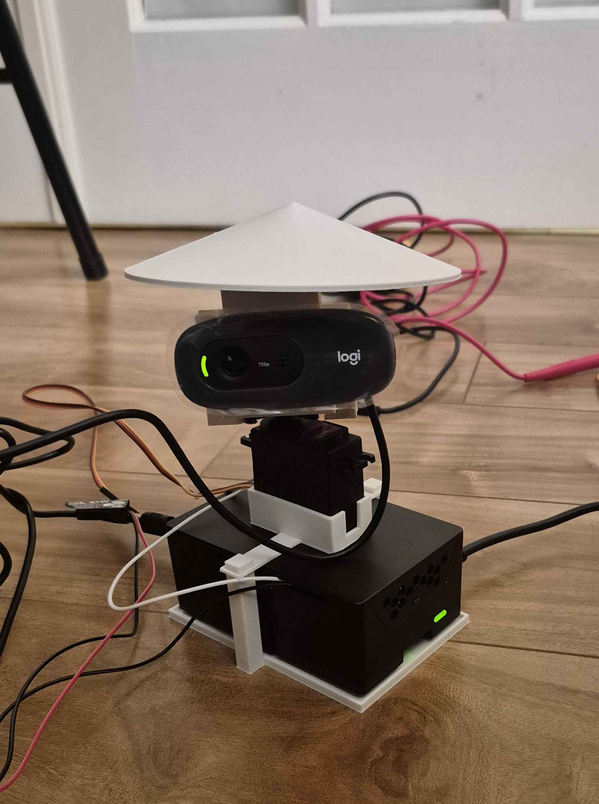

# The Pod: real-time wildlife sensing on QNX



**Hack Western 13 · QNX prize category**

The Pod is a Raspberry Pi 5 running **QNX 8.0** with a USB webcam. It spots animals on the device with an AI detector, turns video into tiny "an animal visited" records, and sends them to a ground station. The ground station estimates how many animals live in each zone, projects the next 10 years, flags sudden drops and slow declines, and suggests where conservation money cuts extinction risk the most.

Camera traps today are checked weeks after the fact. The Pod makes that data live, with bounded and measured latency, and it recovers on its own when something crashes.

## Why it fits the QNX prize

| Requirement | How the Pod meets it |
|---|---|
| Runs on QNX OS | Capture, AI, tracking, logging and uplink all run on QNX 8.0 on a Raspberry Pi 5 |
| An open-source AI module from QNX | **TensorFlow Lite 2.16 from QNX's open-source [qnx-ports](https://github.com/qnx-ports)**, running EfficientDet-Lite0 (int8) |
| Real-time performance or reliability matters | Each stage is its own process with a SCHED_FIFO priority; a supervisor restarts crashed processes; store-and-forward never loses a visit |
| Creative use of AI | Detections feed population estimates, forecasts, early-warning alerts and budget advice for conservation |
| Demo on embedded hardware | Live detection on the Pi, with boxes drawn in the browser through pod-view |

## How it works

```
RASPBERRY PI 5 · QNX 8.0                                LAPTOP · ground station
─────────────────────────                               ───────────────────────
USB webcam                                              ground API :8000 (Python stdlib, SQLite)
  └─ pod-capture  (FIFO 30) ─ shared-memory ring          ├─ stores visits + heartbeats
       └─ pod-infer   TFLite EfficientDet-Lite0           ├─ density   (Random Encounter Model)
            └─ pod-view   live boxes, :8080               ├─ forecast  (Ricker, 1,000 runs)
                 └─ pod-track  one record per visit       ├─ sightings (sudden + trend alerts)
                      └─ pod-log  (FIFO 20) SD card       └─ budget    (risk cut per $1,000)
                           └─ pod-uplink ── Wi-Fi ──►  dashboard :8080 (habitat view + charts)
pod-supervisor (FIFO 40) starts, watches and restarts everything
```

- **Only small sighting records go to the ground station**, never video. People are never stored: the label table has no person class, and the server rejects one.
- **The live camera view (pod-view) is a local setup and demo tool.** It streams video, people included, to browsers on the same network, but saves nothing. Remove its line from `pod/supervisor/pod.conf` for field deployment.
- A visit is about **160 bytes** of JSON.
- **Heartbeats** go out about every 10 s with detection speed, temperature and restarts. They also prove the camera was running, which the population maths needs.

## Run it with the Pi

### What you need

- Raspberry Pi 5 with the **QNX 8.0 quick start image**, and a **Logitech C270** USB webcam in a blue USB 3 port.
- A laptop as the ground station: Python 3.10+, no packages needed.
- A **phone hotspot with internet**. The Pi has no clock battery: it boots in 1970 and gets the time only over the internet. Visits stamped before the clock syncs are dropped.
- SSH key login to the Pi as `qnxuser` (`ssh qnxuser@qnxpi.local`).

### 1. Put the Pi and the laptop on the same network

Join both to the hotspot. The Pi reads its Wi-Fi networks from `/boot/wpa_supplicant.conf`. Add the new network before switching, or the Pi drops off. The details, plus an Ethernet fallback, are in [pod/scripts/NETWORK.md](pod/scripts/NETWORK.md).

Find the laptop's address with `ipconfig` (Windows) or `ip addr`. The Pi answers at `qnxpi.local`.

### 2. Start the ground station on the laptop

From the repo root:

```
python -m ground.api
```

It listens on port 8000. Allow inbound TCP 8000 in the laptop's firewall. The data goes in `ground/db/pod.sqlite3`. Details are in [ground/README.md](ground/README.md).

### 3. Point the Pod at the laptop

On the Pi:

```
echo 'POD_GROUND_URL=http://<laptop-ip>:8000' > ~/pod.env
```

### 4. Put the code and model on the Pi (first time, or after changes)

- **Pod programs:** from the laptop (Git Bash on Windows), run `sh pod/scripts/deploy.sh`. It copies `pod/`, `shared/` and the label table to `~/pod-deploy` on the Pi and builds them there.
- **The AI (TensorFlow Lite, pod-infer, pod-track):** these need the TFLite build on the Pi. See [pod/infer/README.md](pod/infer/README.md).
- **The model:** see [models/README.md](models/README.md). The default is `models/efficientdet_lite0.tflite`.

### 5. Start the Pod

The Pod starts itself at power-on once the boot hook is installed. On the Pi, run this once (it edits a root-owned startup file):

```
sudo sh ~/pod-deploy/pod/scripts/boot_hook.sh install
```

To start or restart it by hand:

```
slay pod-supervisor; sudo sh ~/pod-deploy/pod/scripts/pod_boot.sh
```

`pod_boot.sh` starts the camera service (headless Pod config), the temperature reader, and `pod-supervisor`. The supervisor then starts every program in [pod/supervisor/pod.conf](pod/supervisor/pod.conf): capture, log, uplink, track, infer (through `sudo`, since TFLite needs I/O privilege) and the live view.

To skip auto-start for one boot, run `touch ~/pod-noboot`.

### 6. Check it's working

| Check | Where |
|---|---|
| All Pod programs running | On the Pi, run `pidin -f an \| grep pod-`. Look for supervisor, capture, infer, track, log, uplink and view |
| Boot and supervisor logs | `~/pod-deploy/pod-data/boot.log`, `~/pod-deploy/pod-data/supervisor.log` |
| Live camera with detection boxes | `http://qnxpi.local:8080` |
| Visits and heartbeats arriving | `http://<laptop-ip>:8000/api/summary`: `total_events` rises, and `last_heartbeat` is recent |

### 7. Open the dashboard

On the laptop:

```
python -m http.server 8080 --directory ground/dashboard/sim
```

Then open:

```
http://localhost:8080/?mode=live&api=http://localhost:8000&pod=http://qnxpi.local:8080
```

This shows the habitat view, the charts panel and the live camera panel. The Simulated/Live switch sits at the top centre. Options are in [ground/dashboard/sim/README.md](ground/dashboard/sim/README.md).

### If something's off

| Symptom | Likely cause |
|---|---|
| No visits arrive, and the Pi's `date` says 1970 | No internet at boot, so the clock didn't sync and visits are dropped. Give the hotspot internet and restart the Pod |
| Camera works but nothing is detected | pod-infer isn't running or keeps restarting. Check `pidin` and `supervisor.log` |
| Population numbers say "insufficient data" | No heartbeats yet. Camera time comes only from heartbeats, by design |
| Pod can't reach the laptop | Wrong `POD_GROUND_URL`, the firewall is blocking 8000, or the devices are on different networks |
| New visits silently ignored | The ground database still holds old data for `pod-01` from a wiped Pod. Start a fresh database |

## What's in the repo

| Folder | What | Owner |
|---|---|---|
| `pod/` | Pi programs: capture, infer, track, log, uplink, supervisor, view, scripts | agent-1, agent-2 |
| `models/` | Label table, model download script | agent-2 |
| `shared/` | Contracts: `pod_msgs.h` (C structs), `event_schema.json` (JSON) | everyone |
| `ground/` | Ground API, density, forecast, sightings, budget, backtest, tests | agent-3 |
| `ground/dashboard/` | Habitat view, charts, live camera panel | agent-4 |
| `demo/` | Laptop animal scanner for the demo set | agent-4 |
| `docs/` | Open questions and decisions | agent-4 |

## Status (2026-11-22)

- **Working on the Pi:** camera capture at about 15–20 fps; on-device detection (agent-2 measured inference at **67–68 ms median, 69–73 ms p99** on an idle Pi); tracking, logging and store-and-forward uplink (a server outage lost 0 of 45 events in agent-1's test); supervisor restarts; start at power-on; heartbeats reaching the ground station.
- **Ground station:** all science endpoints are built and tested (105 tests), and on the Pi they answer in 0.3–3.3 s the first time and about 10 ms after that.
- **CPU stress test (P3-2, agent-2's bench on the Pi, 4 CPU-hog loops):**

  | AI priority | Frames/s | Camera→detection p99 | Frames over 200 ms |
  |---|---|---|---|
  | No load | 14.1 | 129 ms | 0% |
  | Load, normal priority | 0.4 | 2,605 ms | 100% |
  | **Load, SCHED_FIFO 15** | **11.2** | **150 ms** | **0%** |

  With real-time priority, QNX keeps detection latency bounded under full load. **The deployed `pod.conf` still starts pod-infer at default priority**, which collapses under load and measured p99 410 ms even without a hog. It needs `SCHED_FIFO 15` before this claim holds for the running Pod. Details are in [pod/infer/README.md](pod/infer/README.md).
- **In progress:** pod-infer at real-time priority in the deployed config, plus a stress-test demo script (agent-1); dashboard panels for the forecast, budget and alerts (P3-5); demo set, slides and backup video.
- The live task board is [TASKS.md](TASKS.md), and every change is in [LOG.md](LOG.md) and `logs/`.

## Honest limits

- **The ecology settings are illustrative**, and every result says so. Travel distances, growth rates, threat levels, and action costs and effects are placeholders until ecologists supply real ones.
- **The forecast shows uncertainty, not a prediction.** Back-tested on real Isle Royale moose counts from 1980–2026, its 90% range held the real count 94% of the time on years it was never tuned on. Its single best-guess line was no better than "nothing changes". See [ground/README.md](ground/README.md).
- **The detector knows the 10 COCO animals** (bird, cat, dog, horse, sheep, cow, elephant, bear, zebra, giraffe), plus a demo-only `teddy_bear` class for the plush set.
- **Multi-week history in the demo is generated** in exactly the Pod's format, because a hackathon can't wait a month for real visits. It's labelled as generated.

## How the team works

Four people, each with a Claude agent and their own lane of files. The rules are in [AGENTS.md](AGENTS.md): claim a task in `TASKS.md`, stay in your lane, and log every change with `python scripts/log.py add`. Judges' Q&A for the science is in [ground/QA_SCIENCE.md](ground/QA_SCIENCE.md).

## Credits

- Population method: Rowcliffe, J. M., Field, J., Turvey, S. T. & Carbone, C. (2008). *Estimating animal density using camera traps without the need for individual recognition.* Journal of Applied Ecology 45: 1228–1236.
- Backtest data: U.S. National Park Service, Isle Royale wolf and moose populations, 1980–2026 (public domain).
- TensorFlow Lite on QNX: QNX qnx-ports.
